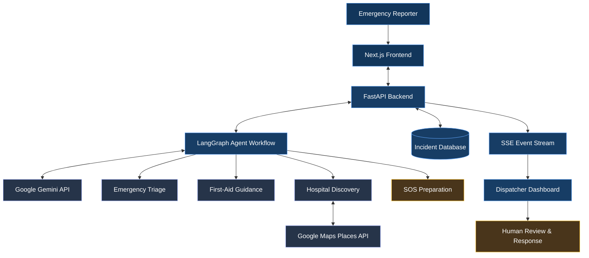
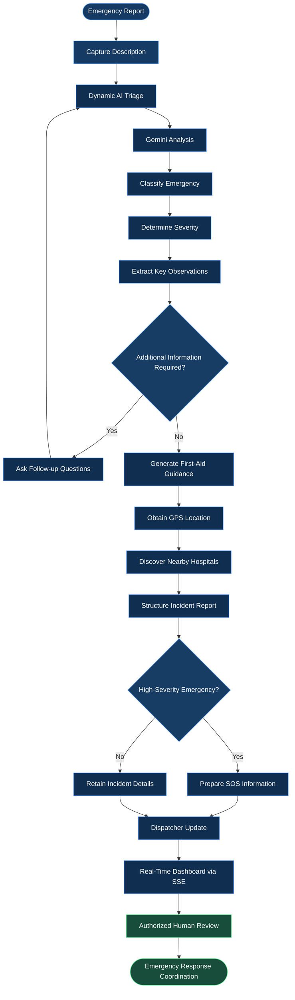
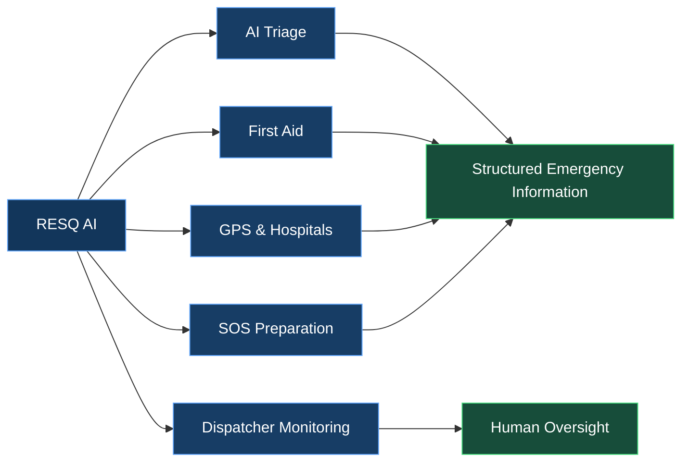

# RESQ AI
### Agentic AI Emergency Response Platform

RESQ AI is a full-stack AI-powered emergency response platform that combines **dynamic emergency triage, first-aid guidance, GPS-based hospital discovery, SOS preparation, and real-time dispatcher monitoring** into a unified workflow.

The system uses Google Gemini and LangGraph to assist with emergency analysis while connecting location services and incident information to a dispatcher-facing interface.

**Core idea:** Turn an emergency description into structured, location-aware information that supports human decision-making.

> ⚠️ RESQ AI is an assistive prototype and does not replace professional medical care or emergency services.

## 🌐 Live Application

| Component | Link |
|---|---|
| Frontend | https://resq-ai-emergency.vercel.app/ |
| Backend API | https://resq-ai-ls67.onrender.com |
| Health Check | https://resq-ai-ls67.onrender.com/api/health |

## 🏗️ System Architecture

**Architecture overview**

- **Frontend:** Captures emergency information and displays results.
- **Backend:** Coordinates API requests, processing, and incident data.
- **Agent workflow:** Orchestrates AI-assisted analysis and emergency-related tasks.
- **External services:** Provide generative AI and nearby hospital information.
- **Dispatcher dashboard:** Presents configured incident updates for human review.

*The diagram represents the intended architecture. Confirm actual database persistence, event streaming, and integrations against the deployed implementation.*

## ⚙️ Emergency Processing Pipeline

### Pipeline stages

| Stage | Operation |
|---|---|
| 01 | Capture the emergency description |
| 02 | Analyze the report using the AI workflow |
| 03 | Determine category, severity, and observations |
| 04 | Ask follow-up questions when needed |
| 05 | Generate situation-specific first-aid guidance |
| 06 | Use GPS to support nearby hospital discovery |
| 07 | Prepare structured incident and SOS information |
| 08 | Stream configured updates to the dispatcher dashboard |
| 09 | Support human review and response coordination |

**Important:** AI severity classification is advisory. The application must not delay emergency services while collecting additional information or processing an incident.

## 🚑 Core Capabilities

### Feature breakdown

- **AI Triage:** Emergency classification, severity assessment, and relevant observations.
- **First Aid:** Concise, situation-specific assistance.
- **GPS & Hospitals:** Browser geolocation and nearby hospital discovery.
- **SOS Preparation:** Structured incident details for potential alert workflows.
- **Dispatcher Monitoring:** Incident visibility and configured real-time updates.
- **Human Oversight:** Emergency information remains subject to professional judgment.
