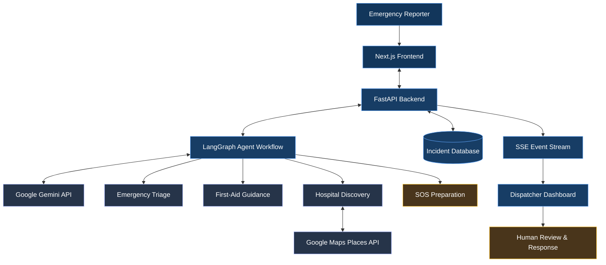

# RESQ AI
### Agentic AI Emergency Response Platform

RESQ AI is a full-stack AI-powered emergency response platform that combines **dynamic emergency triage, first-aid guidance, GPS-based hospital discovery, SOS preparation, and real-time dispatcher monitoring** into a unified workflow.

The system uses Google Gemini and LangGraph to assist with emergency analysis while connecting location services and incident information to a dispatcher-facing interface.

**Core idea:** Turn an emergency description into structured, location-aware information that supports human decision-making.

> ⚠️ RESQ AI is an assistive prototype and does not replace professional medical care or emergency services.

## 🌐 Live Application

| Component | Link |
|---|---|
| Frontend | https://resq-ai-emergency.vercel.app/ |
| Backend API | https://resq-ai-ls67.onrender.com |
| Health Check | https://resq-ai-ls67.onrender.com/api/health |

## 🏗️ System Architecture

**Architecture overview**

- **Frontend:** Captures emergency information and displays results.
- **Backend:** Coordinates API requests, processing, and incident data.
- **Agent workflow:** Orchestrates AI-assisted analysis and emergency-related tasks.
- **External services:** Provide generative AI and nearby hospital information.
- **Dispatcher dashboard:** Presents configured incident updates for human review.

*The diagram represents the intended architecture. Confirm actual database persistence, event streaming, and integrations against the deployed implementation.*
